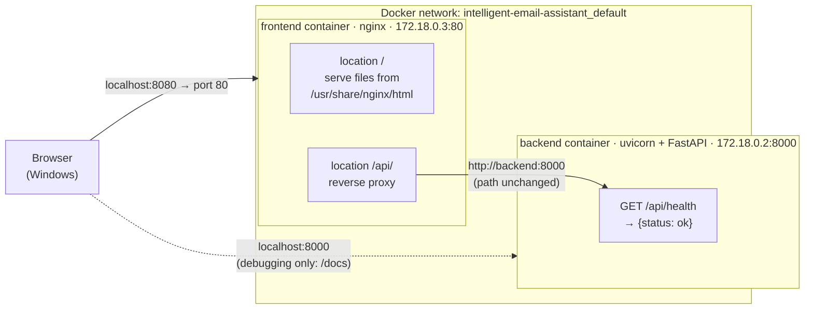
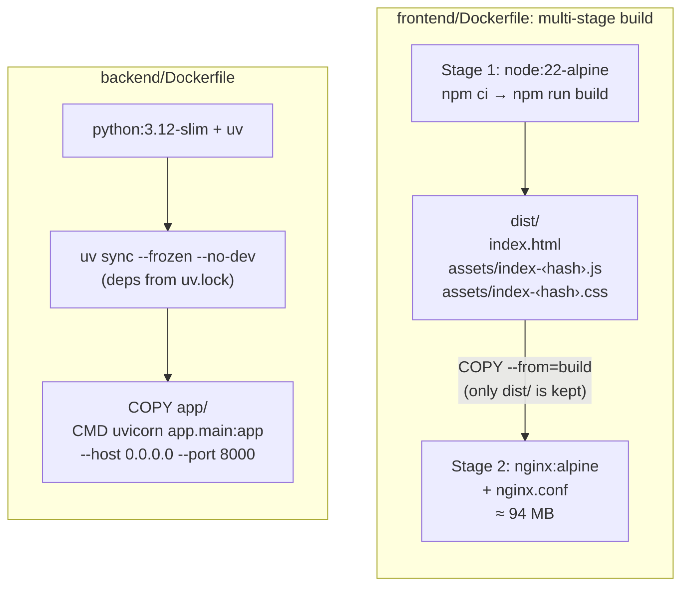
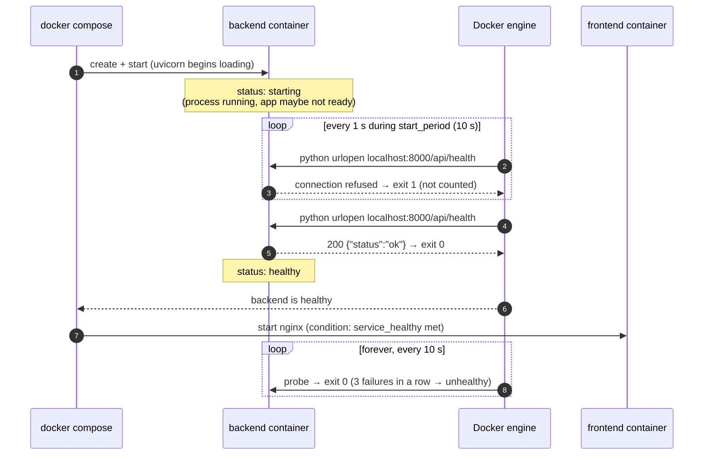
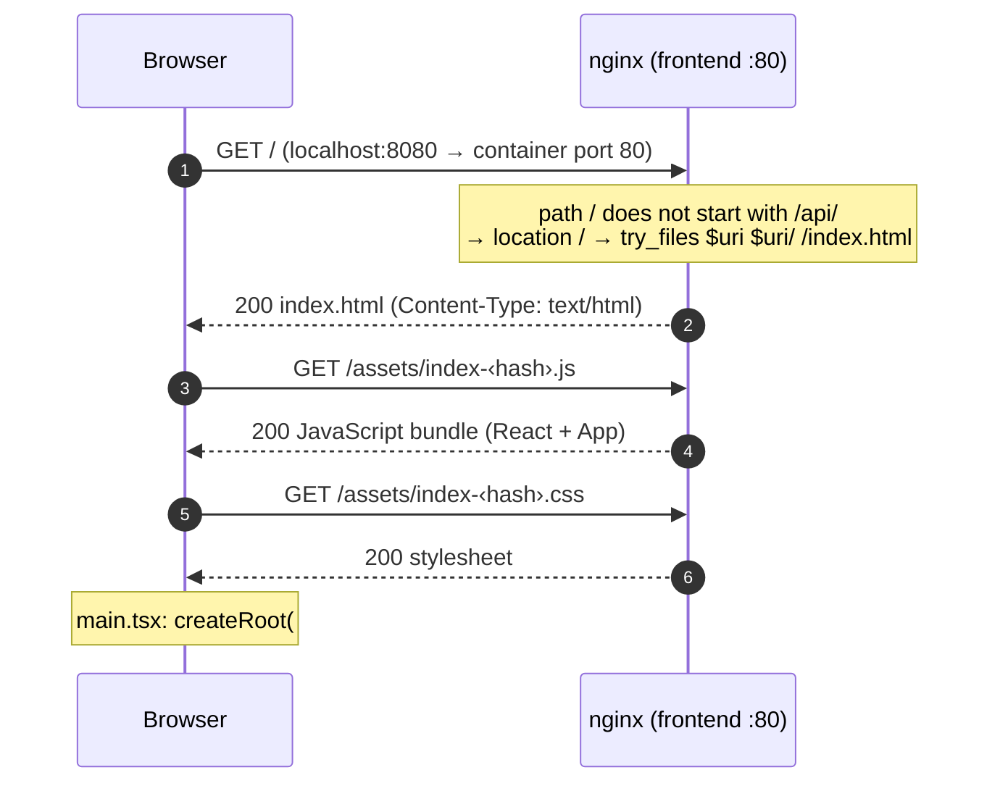
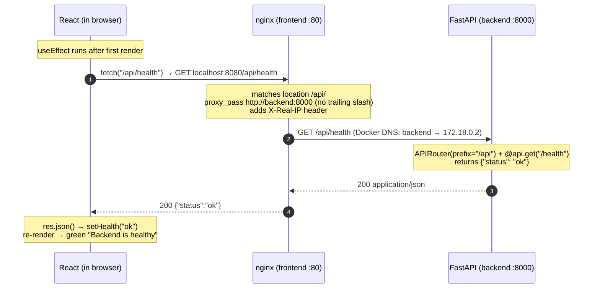
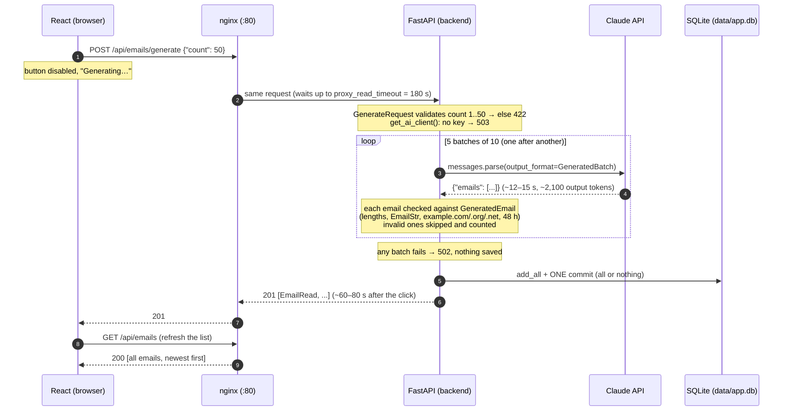
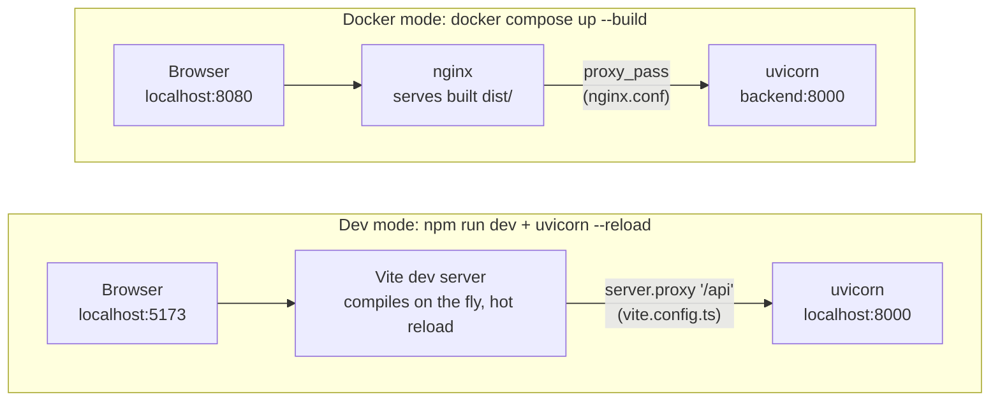

# How a request flows: frontend ↔ backend

> **What this explains:** what happens, step by step, when you open
> `http://localhost:8080/`: how the React frontend reaches the FastAPI backend, how
> Docker's healthcheck decides the backend is ready, and what happens when you click
> **Generate emails** (frontend → nginx → FastAPI → Claude → SQLite).
> Applies to the stack started with `docker compose up --build`.
> Diagrams are [Mermaid](https://mermaid.js.org/); GitHub renders them, and so does VS Code
> with the recommended *Markdown Preview Mermaid Support* extension.

---

## Contents

1. [The big picture](#1-the-big-picture)
2. [Build time: making the two images](#2-build-time-making-the-two-images)
3. [Startup: networking and the healthcheck](#3-startup-networking-and-the-healthcheck)
4. [Loading the page: `GET /`](#4-loading-the-page-get-)
5. [Calling the API: `GET /api/health`](#5-calling-the-api-get-apihealth)
6. [Generating emails: `POST /api/emails/generate`](#6-generating-emails-post-apiemailsgenerate)
7. [Why one origin: no CORS needed](#7-why-one-origin-no-cors-needed)
8. [Dev mode vs Docker mode](#8-dev-mode-vs-docker-mode)
9. [When it breaks: symptoms and causes](#9-when-it-breaks-symptoms-and-causes)
10. [Try it yourself](#10-try-it-yourself)
11. [Glossary](#11-glossary)

---

## 1. The big picture

Opening `http://localhost:8080/` triggers **two separate things**, in order:

1. **Page load:** nginx hands the browser static files (HTML, JS, CSS). Python is not involved.
2. **API call:** the JavaScript in those files sends `fetch("/api/health")`. nginx
   *forwards* that request to FastAPI and passes the answer back.



| Piece | File | Job |
|---|---|---|
| Compose | [`docker-compose.yml`](../docker-compose.yml) | Builds both images, creates the network, maps ports, runs the healthcheck |
| nginx | [`frontend/nginx.conf`](../frontend/nginx.conf) | Serves the built React app; proxies `/api/*` to the backend |
| React | [`frontend/src/`](../frontend/src/) (`App.tsx`, `api.ts`, `components/`) | Runs **in the browser**; calls `/api/...` and shows the results |
| FastAPI | [`backend/app/main.py`](../backend/app/main.py) | Answers `/api/...` requests |

---

## 2. Build time: making the two images

`docker compose up --build` first builds an image for each service.



**Frontend: a multi-stage build** (one image builds the app, a second, smaller one runs it):

- **Stage 1** uses Node to compile TypeScript and React into plain files browsers understand (`dist/`).
- **Stage 2** starts fresh from `nginx:alpine` and copies in **only** `dist/` and `nginx.conf`.
  Node, `node_modules` and the source code are all thrown away.

> **Key insight:** in production there is **no Node.js and no React server**. nginx just hands
> out files; **React runs inside your browser**.

The random part of `index-‹hash›.js` is a **content hash**. It changes whenever the code
changes, so browsers never use a stale cached copy.

**Backend:** installs exact dependency versions from `uv.lock`, then starts uvicorn.
`--host 0.0.0.0` matters: it tells uvicorn to accept connections from outside the
container. With the default `127.0.0.1`, only processes in the same container could
connect, and nginx could not reach it.

---

## 3. Startup: networking and the healthcheck

### 3.1 Docker DNS: how nginx finds "backend"

Compose puts both containers on a private network and gives each one a **DNS name equal
to its service name**. From inside the frontend container:

```console
$ docker compose exec frontend getent hosts backend
172.18.0.2        backend  backend
```

That's why `nginx.conf` can say `proxy_pass http://backend:8000;` without knowing any IP address.

### 3.2 The healthcheck: "started" is not "ready"

```yaml
# docker-compose.yml (backend)
healthcheck:
  test: ["CMD", "python", "-c", "import urllib.request; urllib.request.urlopen('http://localhost:8000/api/health', timeout=2)"]
  interval: 10s        # after startup: probe every 10 s
  timeout: 3s          # a probe slower than this counts as failed
  retries: 3           # 3 failures in a row → "unhealthy"
  start_period: 10s    # grace period: failures don't count yet
  start_interval: 1s   # during the grace period, probe every 1 s

# docker-compose.yml (frontend)
depends_on:
  backend:
    condition: service_healthy   # wait for a passing check, not just a running container
```

- The probe runs **inside the backend container** (hence `localhost:8000`). It uses Python
  because `python:3.12-slim` has no `curl`.
- The result is the command's **exit code**: `0` means healthy, anything else means failed.
  If the URL doesn't answer, `urlopen` raises an error and Python exits with `1`.
- In the backend log, probes appear as `127.0.0.1 - "GET /api/health" 200`: the address is
  127.0.0.1 because the request comes from inside the container itself.



> **Why we added it:** without `condition: service_healthy`, nginx started as soon as the
> backend *container* existed. For the first second or two the browser got
> **502 Bad Gateway** and the page showed "Backend unreachable".

### 3.3 Two different "health checks": don't mix them up

| | Docker healthcheck | Status pill on the page |
|---|---|---|
| Who runs it | Docker engine | Your browser (JavaScript in `HealthPill.tsx`) |
| Path taken | inside backend container → `localhost:8000` | browser → nginx → backend |
| What it proves | the API process is up | the **whole chain** works: port mapping, nginx, proxy, API |
| When | every 10 s, forever | once per page load |

---

## 4. Loading the page: `GET /`



1. **Port mapping:** `ports: "8080:80"` means traffic to port 8080 on your machine goes to
   port 80 inside the frontend container. Docker Desktop routes Windows `localhost` into WSL.
2. **nginx picks a `location` block:** the path `/` doesn't start with `/api/`, so it uses
   `location /`.
3. **`try_files $uri $uri/ /index.html`:** nginx tries a matching file, then a folder, and
   falls back to `index.html`.
4. **The browser reads the HTML,** finds the `<script>` and `<link>` tags, and asks for the
   JS and CSS files, which nginx also serves straight from disk.
5. **React starts in the browser:** `main.tsx` finds `<div id="root">` and renders `<App />`.

> **SPA fallback:** a deep link like `/emails/42` has no file on disk, so `try_files`
> returns `index.html` and React decides what to show. Without this rule, refreshing such
> a page would give an nginx 404.

---

## 5. Calling the API: `GET /api/health`



6. **`useEffect`** in [`HealthPill.tsx`](../frontend/src/components/HealthPill.tsx) calls `fetch('/api/health')`.
   It's a **relative URL**, so the browser sends it to the same place the page came
   from: `localhost:8080`.
7. **nginx matches `location /api/`** and acts as a **reverse proxy**: it forwards the
   request to `http://backend:8000`.
   - **No trailing slash** after `8000` means the path is passed through unchanged
     (`/api/health` stays `/api/health`).
   - With `http://backend:8000/` (trailing slash), nginx would *strip* `/api/` and send
     `/health`, which returns a 404. That was a real bug fixed during Epic 0.
8. **FastAPI routes it:** the prefix `/api` plus the route `/health` adds up to `/api/health`.
   The function returns a Python dict, which FastAPI converts to JSON. The backend log
   shows the caller as `172.18.0.3`, the nginx container, not your browser.
9. **Back in the browser:** `res.json()` parses the JSON, `setHealth('ok')` updates the
   state, and React re-renders the pill green. Any failure (502, network error, bad JSON)
   goes to `.catch()`, which sets `'down'` and turns the pill red.

> **Tip:** `curl -I localhost:8080/api/health` returns **405 Method Not Allowed**. `-I`
> sends `HEAD` and the route only allows `GET`. That 405 proves the request reached
> FastAPI; nginx alone would never answer 405 here.

---

## 6. Generating emails: `POST /api/emails/generate`

What happens when you enter **50** and click **Generate emails** (Docker mode).



1. **React** ([`App.tsx`](../frontend/src/App.tsx) → [`api.ts`](../frontend/src/api.ts))
   sends the POST and disables the button. `fetch` itself has no timeout, so the browser
   waits as long as nginx does.
2. **nginx** forwards it like any `/api/` call, but this request is *slow*, so the
   **timeout** matters (table below).
3. **FastAPI** ([`routers/emails.py`](../backend/app/routers/emails.py)) validates the
   body and resolves the dependencies (`get_session`, `get_ai_client`). The endpoint is a
   plain `def`, so it runs in a worker thread and other requests (like `/api/health`)
   keep being answered.
4. **The generator** ([`services/generator.py`](../backend/app/services/generator.py))
   asks Claude for at most **10 emails per call**, through the only module that talks to
   Claude ([`services/ai_client.py`](../backend/app/services/ai_client.py)). Claude
   returns `received_minutes_ago`; Python computes the UTC `received_at`.
5. **Validation:** every email is checked separately; bad ones are skipped (logged as
   counts, never content). So 50 requested can return a few less (e.g. 45).
6. **One transaction:** Claude runs *before* the database is touched, then all emails are
   saved with one `commit()`. An AI failure can never leave half-saved data.
7. **The UI refreshes the list** with `GET /api/emails`, sorted newest first.

### Every layer has a timeout: the shortest one wins

| Layer | Timeout | What the user sees when it fires |
|---|---|---|
| Browser `fetch` | none | (keeps waiting) |
| nginx `proxy_read_timeout` ([`nginx.conf`](../frontend/nginx.conf)) | **180 s** (default 60 s) | **504** "took too long" banner, *but the backend may still finish and save* |
| Claude SDK, per call (`AI_TIMEOUT_SECONDS`) | 30 s, + 1 retry | **502** "AI service error: request timed out" |
| Vite dev proxy (`:5173`) | none | (keeps waiting) |

Measured on 2026-11-21 ([test log](testing/epic-1.md)): 50 emails = 5 calls of 12–13 s
= **~60 s**. With nginx's default 60 s, the browser got a **504 after ~57 s while the
backend still saved 45 emails**: the user is told "failed" although it worked, and a
second click makes duplicates. Raising nginx's limit to 180 s fixed it (201 after 60.3 s).

### How errors map to HTTP status

| Situation | Status | Where it's decided |
|---|---|---|
| `count` not 1–50, scenario > 200 chars | 422 | `GenerateRequest` (automatic) |
| `ANTHROPIC_API_KEY` missing or rejected | 503 | `AIConfigError` handler in `main.py` |
| Claude timeout, rate limit, error, or no valid emails | 502 | `AIServiceError` handler in `main.py` |
| nginx gave up waiting | 504 | nginx (HTML page; `api.ts` shows "took too long") |

**Cost:** about **$0.0015 per 10 emails** with `claude-haiku-5-5` (~900 input and ~2,100
output tokens per batch). Every call logs its tokens: `docker compose logs backend | grep "Claude call"`.

---

## 7. Why one origin: no CORS needed

An **origin** is scheme + host + port (`http://localhost:8080`). Browsers enforce the
**same-origin policy**: JavaScript can't freely read responses from a *different* origin
unless that server opts in with **CORS** headers.

Because nginx serves the page **and** proxies the API on the same origin:

- the browser never makes a cross-origin request, so FastAPI needs **no CORS configuration**;
- only nginx has to be public; the backend can stay private (port 8000 is exposed only
  for local debugging, e.g. `http://localhost:8000/docs`);
- the frontend code (`fetch('/api/...')`) is identical in dev, Docker and the cloud.

---

## 8. Dev mode vs Docker mode



| | Docker mode (`:8080`) | Dev mode (`:5173`) |
|---|---|---|
| Serves the page | nginx, from pre-built `dist/` | Vite, compiled on demand, hot reload |
| Forwards `/api` | `proxy_pass` in `nginx.conf` | `server.proxy` in `vite.config.ts` |
| Backend address | `backend` (Docker DNS) | `localhost` (both run in WSL) |
| Use it for | checking the real production setup | day-to-day coding |

The frontend code doesn't know or care which mode it's in.

---

## 9. When it breaks: symptoms and causes

| Symptom | Likely cause | Check |
|---|---|---|
| Page loads, pill is red, Network tab shows **502** on `/api/health` | nginx can't reach the backend (stopped, crashed, still starting) | `docker compose ps`, `docker compose logs backend` |
| **404** on `/api/...` with a FastAPI JSON body `{"detail":"Not Found"}` | Route path mismatch (prefix missing, trailing slash on `proxy_pass`) | Compare the path in the backend log with `main.py` |
| **404** from nginx (HTML page) on a deep link like `/emails/42` | SPA fallback missing | `try_files ... /index.html` in `nginx.conf` |
| **405** Method Not Allowed | Wrong HTTP method (e.g. `HEAD` or `POST` on a `GET` route) | The method in DevTools vs the decorator in FastAPI |
| `backend` shows **(unhealthy)** | App not answering `/api/health` inside the container | `docker inspect <container> --format '{{json .State.Health}}'` |
| Frontend never starts | Waiting on `service_healthy` and the backend never becomes healthy | Same as above, and `docker compose logs backend` |
| Dev mode: red pill on `:5173` | uvicorn not running, or Vite started before `vite.config.ts` changed | Start uvicorn; restart `npm run dev` |
| Generate shows **503** "AI is not configured" | No `ANTHROPIC_API_KEY` in `.env` (or the container started before you added it) | Set the key, then `docker compose up -d backend` |
| Generate shows **502** "AI service error: …" | Claude timed out, was rate limited, or returned nothing valid | `docker compose logs backend \| grep -E "Claude call\|failed"` |
| Generate shows **504** "took too long", but the emails appear after a refresh | nginx gave up before the backend finished | `proxy_read_timeout` in `nginx.conf`; generate fewer at once |
| `localhost:8080` shows an **old** version that `docker ps` doesn't list | A second Docker Engine inside WSL holds the ports | `systemctl is-active docker`; see README "Docker and the `data/` folder" |
| From a WSL terminal, `curl localhost:8080` fails but the Windows browser works | Older Docker Desktop setups publish ports only on Windows | Use the Windows host IP: `ip route \| awk '/default/ {print $3}'` |
| Dev mode: `uvicorn` fails with *address already in use*, or `:5173` shows Docker's data | The Docker backend holds port 8000 (also inside WSL) | `docker compose stop backend` before dev mode |

---

## 10. Try it yourself

`localhost` works in a Windows browser and, with current Docker Desktop, in a WSL
terminal too. If it doesn't in WSL on your setup, use the Windows host IP
(`ip route | awk '/default/ {print $3}'`).

```bash
# Watch both sides of every request
docker compose logs -f frontend backend

# Healthcheck history (exit codes + timestamps)
docker inspect intelligent-email-assistant-backend-1 --format '{{json .State.Health}}'

# Break it on purpose: the page pill turns red, nginx returns 502
docker compose stop backend
docker compose start backend      # healthy again within a few seconds

# Docker DNS from inside the frontend container
docker compose exec frontend getent hosts backend

# Same endpoint three ways
curl localhost:8080/api/health    # browser path: via nginx
curl localhost:8000/api/health    # straight to the backend (debugging)
curl -I localhost:8080/api/health # HEAD → 405 from FastAPI

# Generate 2 emails through nginx (costs ~$0.0003) and watch the token log
curl -X POST localhost:8080/api/emails/generate -H 'Content-Type: application/json' -d '{"count": 2}'
docker compose logs backend | grep -E "Claude call|Generated"
curl localhost:8080/api/emails     # all stored emails, newest first
```

In the browser: **F12 → Network**, reload, and look for `index.html`, the `.js`/`.css`
assets, then `health`. Click `health` to see headers and the JSON response.

---

## 11. Glossary

| Term | Plain meaning |
|---|---|
| **Container / image** | An image is a packaged app + its OS files; a container is a running copy of it. |
| **Multi-stage build** | A Dockerfile with several `FROM`s; build in one, copy only the result into a small final image. |
| **Port mapping** (`8080:80`) | "Traffic to port 8080 on my machine goes to port 80 in the container." |
| **Docker DNS** | Inside a Compose network, each service name (e.g. `backend`) resolves to that container's IP. |
| **Healthcheck** | A command Docker runs periodically; exit code `0` means healthy. |
| **`depends_on` + `service_healthy`** | Start this service only after that one passes its healthcheck. |
| **Reverse proxy** | A server that receives requests and forwards them to another server on the client's behalf (nginx → FastAPI). |
| **SPA (single-page app)** | One HTML page; JavaScript switches views without full page reloads. |
| **SPA fallback** | Serve `index.html` for unknown paths so the front-end router can handle them. |
| **Origin / same-origin policy / CORS** | Browsers isolate scheme+host+port; CORS headers let a server allow other origins. |
| **`useEffect`** | React hook that runs code after a component renders, used here to call the API once. |
| **Content hash** | Fingerprint in a file name that changes when contents change, so caches never go stale. |
| **504 Gateway Timeout** | The proxy (nginx) stopped waiting for the backend. The backend may still finish the work. |
| **`proxy_read_timeout`** | How long nginx waits for the backend's answer before returning 504 (default 60 s; here 180 s). |
| **Structured output** | Claude is constrained to answer in a JSON schema built from a Pydantic model. |
| **Transaction / commit** | A group of database writes saved together: all of them, or none. |
| **Bind mount** | A host folder mounted into a container (`./data:/app/data`), so data survives `docker compose down`. |
| **`restart: unless-stopped`** | Docker starts the container again when Docker starts, unless you stopped it yourself. |
