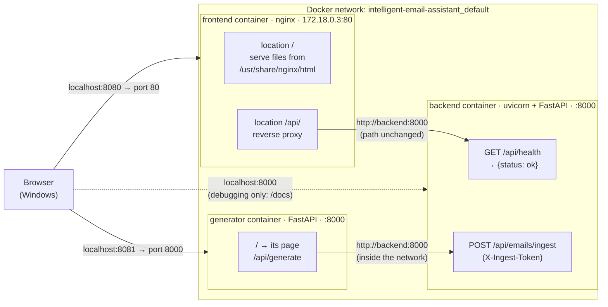
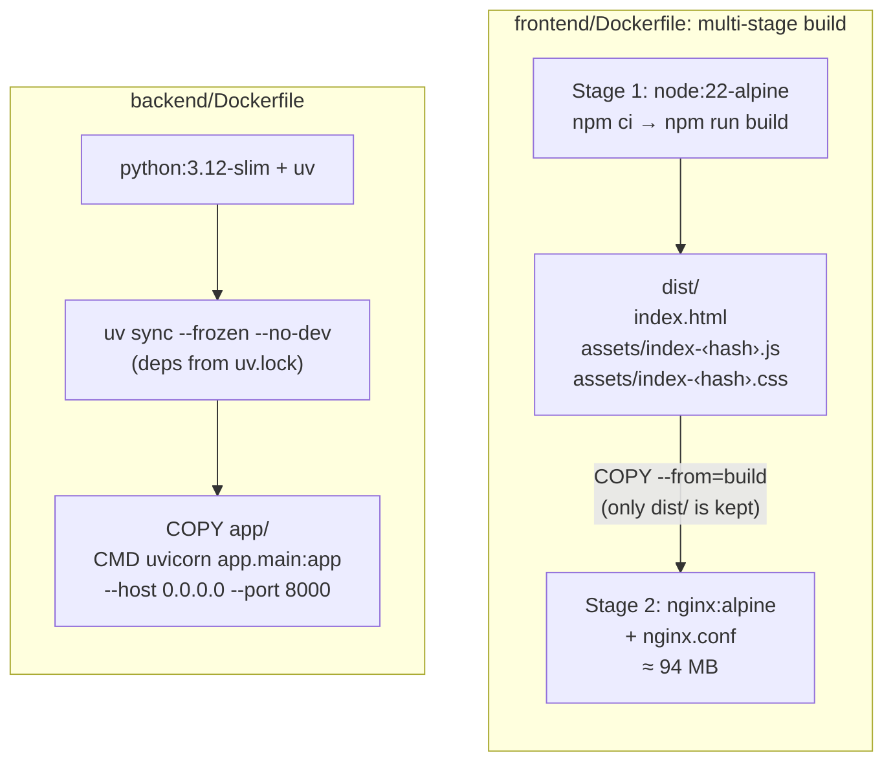
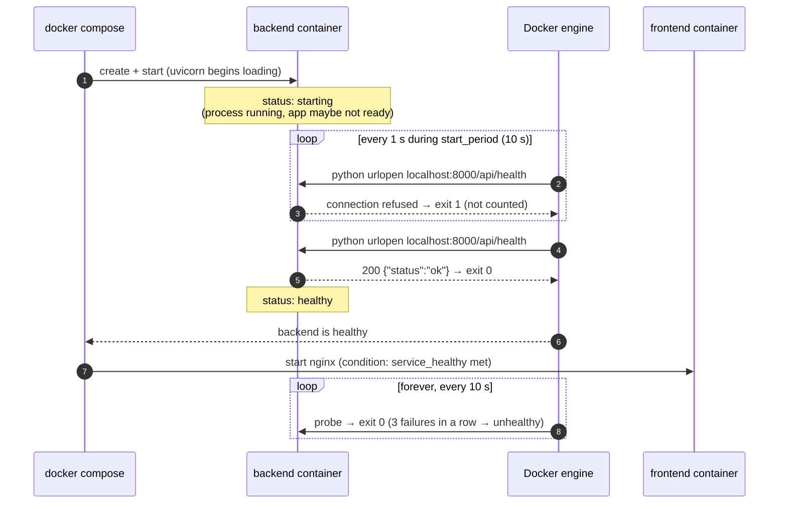
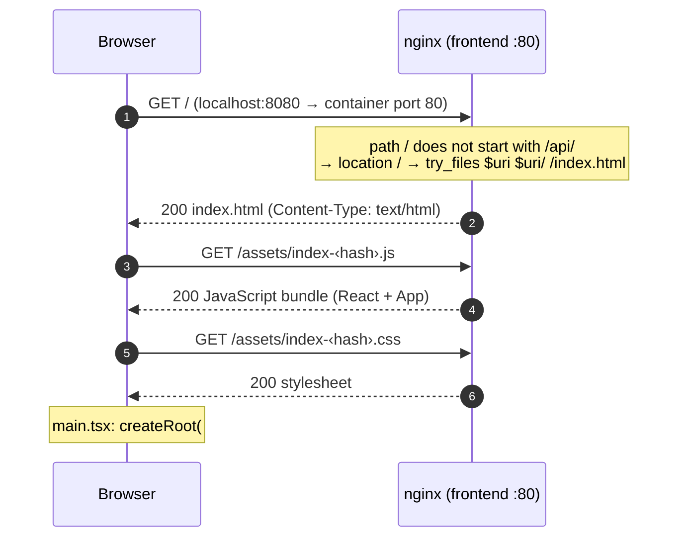
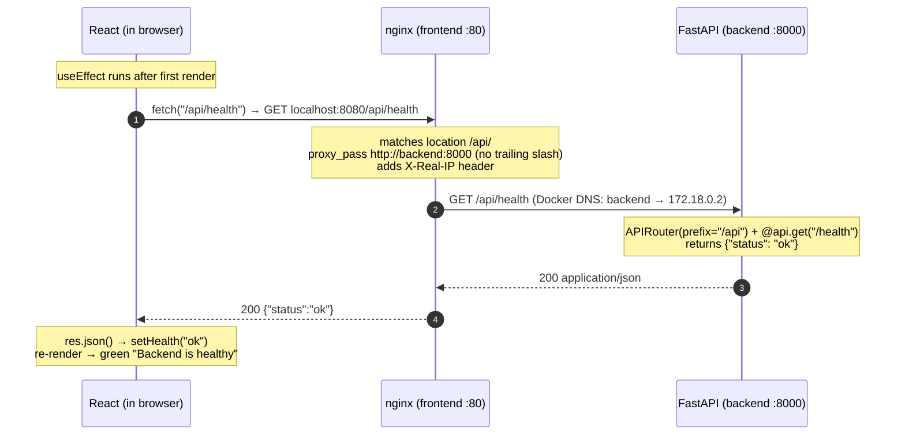
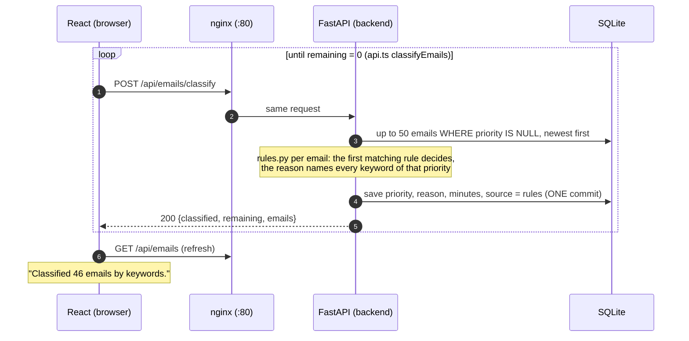
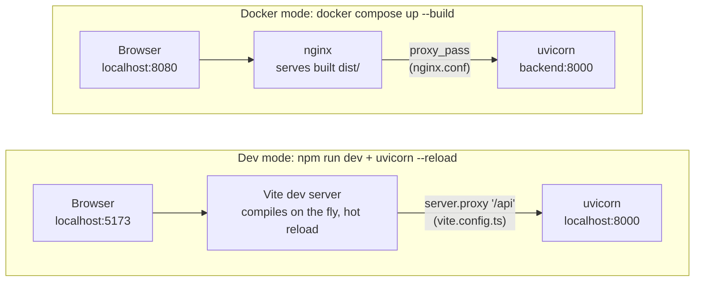

# How a request flows: frontend ↔ backend

> **What this explains:** what happens, step by step, when you open the inbox
> (`http://localhost:8080/`): how the React frontend reaches the FastAPI backend, how
> Docker's healthcheck decides the backend is ready, how the separate **Email Generator**
> (`http://localhost:8081/`) writes emails with Claude and **delivers** them to the inbox,
> how the inbox notices new mail, and how **Classify** decides with keyword rules.
> Applies to the stack started with `docker compose up --build` (three services since Epic 3b).
> Diagrams are [Mermaid](https://mermaid.js.org/); GitHub renders them, and so does VS Code
> with the recommended *Markdown Preview Mermaid Support* extension.

---

## Contents

1. [The big picture](#1-the-big-picture)
2. [Build time: making the three images](#2-build-time-making-the-three-images)
3. [Startup: networking and the healthcheck](#3-startup-networking-and-the-healthcheck)
4. [Loading the page: `GET /`](#4-loading-the-page-get-)
5. [Calling the API: `GET /api/health`](#5-calling-the-api-get-apihealth)
6. [Generate → deliver → arrive: the two apps together](#6-generate--deliver--arrive-the-two-apps-together)
7. [Classifying emails: `POST /api/emails/classify`](#7-classifying-emails-post-apiemailsclassify)
8. [The inbox: views, summary and Trash](#8-the-inbox-views-summary-and-trash)
9. [Why one origin: no CORS needed](#9-why-one-origin-no-cors-needed)
10. [Dev mode vs Docker mode](#10-dev-mode-vs-docker-mode)
11. [When it breaks: symptoms and causes](#11-when-it-breaks-symptoms-and-causes)
12. [Try it yourself](#12-try-it-yourself)
13. [Glossary](#13-glossary)

---

## 1. The big picture

The stack has **three containers** on one Docker network: the inbox's **frontend**
(nginx) and **backend** (FastAPI + SQLite), and the **generator** (FastAPI serving its own
page and API). The generator talks to the inbox only through one API call (§6).

Opening `http://localhost:8080/` triggers **two separate things**, in order:

1. **Page load:** nginx hands the browser static files (HTML, JS, CSS). Python is not involved.
2. **API call:** the JavaScript in those files sends `fetch("/api/health")`. nginx
   *forwards* that request to FastAPI and passes the answer back.



| Piece | File | Job |
|---|---|---|
| Compose | [`docker-compose.yml`](../docker-compose.yml) | Builds both images, creates the network, maps ports, runs the healthcheck |
| nginx | [`frontend/nginx.conf`](../frontend/nginx.conf) | Serves the built React app; proxies `/api/*` to the backend |
| React | [`frontend/src/`](../frontend/src/) (`App.tsx`, `api.ts`, `components/`) | Runs **in the browser**; calls `/api/...` and shows the results |
| FastAPI | [`backend/app/main.py`](../backend/app/main.py) | Answers `/api/...` requests |
| Generator | [`generator/`](../generator/) (`app/`, `web/`) | Its page + `POST /api/generate`: Claude, then delivery to the inbox |

---

## 2. Build time: making the three images

`docker compose up --build` first builds an image for each service. The generator's
image ([`generator/Dockerfile`](../generator/Dockerfile)) combines both patterns below:
a Node stage builds its page, then a Python stage serves the page **and** its API, so
it needs no nginx of its own (one container, one origin).



**Frontend: a multi-stage build** (one image builds the app, a second, smaller one runs it):

- **Stage 1** uses Node to compile TypeScript and React into plain files browsers understand (`dist/`).
- **Stage 2** starts fresh from `nginx:alpine` and copies in **only** `dist/` and `nginx.conf`.
  Node, `node_modules` and the source code are all thrown away.

> **Key insight:** in production there is **no Node.js and no React server**. nginx just hands
> out files; **React runs inside your browser**.

The random part of `index-‹hash›.js` is a **content hash**. It changes whenever the code
changes, so browsers never use a stale cached copy.

**Backend:** installs exact dependency versions from `uv.lock`, then starts uvicorn.
`--host 0.0.0.0` matters: it tells uvicorn to accept connections from outside the
container. With the default `127.0.0.1`, only processes in the same container could
connect, and nginx could not reach it.

---

## 3. Startup: networking and the healthcheck

### 3.1 Docker DNS: how nginx finds "backend"

Compose puts both containers on a private network and gives each one a **DNS name equal
to its service name**. From inside the frontend container:

```console
$ docker compose exec frontend getent hosts backend
172.18.0.2        backend  backend
```

That's why `nginx.conf` can say `proxy_pass http://backend:8000;` without knowing any IP address.

### 3.2 The healthcheck: "started" is not "ready"

```yaml
# docker-compose.yml (backend)
healthcheck:
  test: ["CMD", "python", "-c", "import urllib.request; urllib.request.urlopen('http://localhost:8000/api/health', timeout=2)"]
  interval: 10s        # after startup: probe every 10 s
  timeout: 3s          # a probe slower than this counts as failed
  retries: 3           # 3 failures in a row → "unhealthy"
  start_period: 10s    # grace period: failures don't count yet
  start_interval: 1s   # during the grace period, probe every 1 s

# docker-compose.yml (frontend)
depends_on:
  backend:
    condition: service_healthy   # wait for a passing check, not just a running container
```

- The probe runs **inside the backend container** (hence `localhost:8000`). It uses Python
  because `python:3.12-slim` has no `curl`.
- The result is the command's **exit code**: `0` means healthy, anything else means failed.
  If the URL doesn't answer, `urlopen` raises an error and Python exits with `1`.
- In the backend log, probes appear as `127.0.0.1 - "GET /api/health" 200`: the address is
  127.0.0.1 because the request comes from inside the container itself.



> **Why we added it:** without `condition: service_healthy`, nginx started as soon as the
> backend *container* existed. For the first second or two the browser got
> **502 Bad Gateway** and the page showed "Backend unreachable".

### 3.3 Two different "health checks": don't mix them up

| | Docker healthcheck | Status pill on the page |
|---|---|---|
| Who runs it | Docker engine | Your browser (JavaScript in `HealthPill.tsx`) |
| Path taken | inside backend container → `localhost:8000` | browser → nginx → backend |
| What it proves | the API process is up | the **whole chain** works: port mapping, nginx, proxy, API |
| When | every 10 s, forever | once per page load |

---

## 4. Loading the page: `GET /`



1. **Port mapping:** `ports: "8080:80"` means traffic to port 8080 on your machine goes to
   port 80 inside the frontend container. Docker Desktop routes Windows `localhost` into WSL.
2. **nginx picks a `location` block:** the path `/` doesn't start with `/api/`, so it uses
   `location /`.
3. **`try_files $uri $uri/ /index.html`:** nginx tries a matching file, then a folder, and
   falls back to `index.html`.
4. **The browser reads the HTML,** finds the `<script>` and `<link>` tags, and asks for the
   JS and CSS files, which nginx also serves straight from disk.
5. **React starts in the browser:** `main.tsx` finds `<div id="root">` and renders `<App />`.

> **SPA fallback:** a deep link like `/emails/42` has no file on disk, so `try_files`
> returns `index.html` and React decides what to show. Without this rule, refreshing such
> a page would give an nginx 404.

---

## 5. Calling the API: `GET /api/health`



6. **`useEffect`** in [`HealthPill.tsx`](../frontend/src/components/HealthPill.tsx) calls `fetch('/api/health')`.
   It's a **relative URL**, so the browser sends it to the same place the page came
   from: `localhost:8080`.
7. **nginx matches `location /api/`** and acts as a **reverse proxy**: it forwards the
   request to `http://backend:8000`.
   - **No trailing slash** after `8000` means the path is passed through unchanged
     (`/api/health` stays `/api/health`).
   - With `http://backend:8000/` (trailing slash), nginx would *strip* `/api/` and send
     `/health`, which returns a 404. That was a real bug fixed during Epic 0.
8. **FastAPI routes it:** the prefix `/api` plus the route `/health` adds up to `/api/health`.
   The function returns a Python dict, which FastAPI converts to JSON. The backend log
   shows the caller as `172.18.0.3`, the nginx container, not your browser.
9. **Back in the browser:** `res.json()` parses the JSON, `setHealth('ok')` updates the
   state, and React re-renders the pill green. Any failure (502, network error, bad JSON)
   goes to `.catch()`, which sets `'down'` and turns the pill red.

> **Tip:** `curl -I localhost:8080/api/health` returns **405 Method Not Allowed**. `-I`
> sends `HEAD` and the route only allows `GET`. That 405 proves the request reached
> FastAPI; nginx alone would never answer 405 here.

---

## 6. Generate → deliver → arrive: the two apps together

Since Epic 3b the inbox **never generates**. The **Email Generator** writes emails with
Claude and **delivers** them to the inbox through one small API, like a mail server
delivering to a mail client. Why this design: [ADR 0001](decisions/0001-separate-generator-service.md).

What happens when you type **10** on `http://localhost:8081` and click **Generate**:

```mermaid
sequenceDiagram
    autonumber
    participant G as Generator page (browser :8081)
    participant GA as Generator API (container)
    participant C as Claude API
    participant B as Inbox backend (backend:8000)
    participant D as SQLite
    participant I as Inbox page (browser :8080)

    G->>GA: POST /api/generate {"count": 10, "scenario": "…"}
    Note over GA: no ANTHROPIC_API_KEY or no INGEST_TOKEN → 503<br/>(checked BEFORE paying for a Claude call)
    loop batches of 10 (one after another)
        GA->>C: messages.parse(output_format=GeneratedBatch)
        C-->>GA: {"emails": [...]} (~12–19 s per 10)
        Note over GA: each email checked: fictional domain, lengths,<br/>at most 47 h old; invalid ones skipped
    end
    GA->>B: POST /api/emails/ingest {"emails": [...]}<br/>X-Ingest-Token: ••• (Docker DNS: "backend")
    Note over B: token wrong → 401 · not configured → 503<br/>every email validated AGAIN (IncomingEmail, 48 h)<br/>one invalid → 422, nothing saved
    B->>D: add_all + ONE commit (all or nothing)
    B-->>GA: 201 {"created": 10, "ids": [...]}
    GA-->>G: 201 {"generated": 10, "delivered": 10}
    Note over G: "10 new emails generated and delivered to the inbox"<br/>"Open the inbox ↗" (new tab)
    loop every 15 s (slower in a background tab)
        I->>B: GET /api/emails/summary (via nginx)
    end
    Note over I: all + trash went up by 10 → "10 new emails arrived"<br/>(toast or status line; desktop notification if enabled and hidden)
    I->>B: GET /api/emails (reload the current view)
```

1. **The generator page** ([`generator/web/src/App.tsx`](../generator/web/src/App.tsx))
   posts to its own API (same origin: FastAPI serves the page).
2. **Setup first:** the generator's dependencies (`get_ai_client`, `get_inbox_client`) run
   before the endpoint; a missing key or token answers **503** before any paid Claude call.
3. **Claude** ([`generator/app/services/generator.py`](../generator/app/services/generator.py)):
   batches of 10; Claude says "N minutes ago", Python computes `received_at`. The generator
   accepts at most **47 h**, one hour stricter than the inbox's 48 h, so an email is still
   valid when it arrives (generation can take ~80 s for 50).
4. **Delivery** ([`generator/app/services/inbox.py`](../generator/app/services/inbox.py)):
   one `POST {INBOX_URL}/api/emails/ingest` with the shared token in `X-Ingest-Token`. In
   Docker `INBOX_URL` is `http://backend:8000`: the **service name**, resolved by Docker's
   DNS, on the **internal** port.
5. **The inbox never trusts the sender**
   ([`backend/app/routers/emails.py`](../backend/app/routers/emails.py) `ingest`): the token
   is compared in constant time and checked before the body; every email is validated
   again (`IncomingEmail`; unknown fields like `priority` are rejected); all saved in one
   transaction. Emails arrive **unclassified** and `new`.
6. **The inbox notices new mail** ([`frontend/src/arrivals.ts`](../frontend/src/arrivals.ts)):
   it asks for `/summary` every 15 s; new mail = `all + trash` went up (a delete or an Undo
   leaves that total unchanged, so they never count as new mail). The health pill
   re-checks `/api/health` on the same rhythm, so an outage shows without a reload.

### Every layer has a timeout: the shortest one wins

| Layer | Timeout | What the user sees when it fires |
|---|---|---|
| Browser `fetch` (generator page) | none | (keeps waiting) |
| Claude SDK, per call (`AI_TIMEOUT_SECONDS`) | 30 s, + 1 retry | **502** "AI service error: request timed out" |
| Generator → inbox (`INBOX_TIMEOUT_SECONDS`) | 10 s | **502** "…the inbox did not answer within 10 s. Nothing was delivered." |
| nginx `proxy_read_timeout` (inbox, [`nginx.conf`](../frontend/nginx.conf)) | 180 s | **504** for slow inbox calls (e.g. Classify) |

### How errors map to HTTP status (generator)

| Situation | Status | Message (shown in the generator's red box) |
|---|---|---|
| `count` not 1–50, scenario > 200 chars | 422 | `count: …` |
| No `ANTHROPIC_API_KEY` | 503 | "AI is not configured: set ANTHROPIC_API_KEY in .env" |
| No `INGEST_TOKEN` in the generator | 503 | "Delivery is not configured: set INGEST_TOKEN in .env…" |
| Claude timeout, rate limit, error, no valid emails | 502 | "AI service error: …" |
| Inbox down / slow | 502 | "Generated N emails but the inbox could not be reached at … / did not answer within 10 s. Nothing was delivered." |
| Token differs from the inbox's (inbox 401) | 502 | "…the inbox rejected the token (INGEST_TOKEN must be the same in both services)…" |
| Inbox has no token (inbox 503) | 502 | "…the inbox has ingest disabled…" |

A failed delivery **loses the generated emails** (no retry, no storage in the generator);
that costs ~$0.0015 per 10 and is accepted for a test-data tool.

**Cost:** about **$0.0015 per 10 emails** with `claude-haiku-5-5`. Every call logs its
tokens: `docker compose logs generator | grep "Claude call"`. Measured end to end on
2026-11-26: [docs/testing/epic-3b.md](testing/epic-3b.md).

---

## 7. Classifying emails: `POST /api/emails/classify`

Since #92 the inbox classifies with **keyword rules only**: no AI, no key, no cost
(decision: [ADR 0002](decisions/0002-rules-only-classification.md)). What happens when you
click **Classify** with 46 unclassified emails:



1. **The UI loops** ([`api.ts`](../frontend/src/api.ts) `classifyEmails`): the backend
   does at most **50 emails per request** and answers how many are `remaining`. With the
   rules a request takes milliseconds; the limit just keeps each transaction small.
   Guards: stop if a request makes no progress, or after 20 requests.
2. **Only unclassified emails** are picked (`priority IS NULL`): a manual priority, an
   earlier rules result and the 140 labels Claude gave before #92 (source `ai`) are never
   overwritten, and calling it twice is safe.
3. **The rules** ([`services/rules.py`](../backend/app/services/rules.py)) are an ordered
   table built from brief §7 ([`priorities.py`](../backend/app/priorities.py)):
   critical words → clear low markers (newsletter, FYI) → high words → automated sender
   → otherwise moderate. Words match as whole words, ignoring case ("down" in "is down",
   not in "download").
4. **The reason explains the decision:** every keyword of the deciding priority, in the
   order found, without duplicates, at most 4, plus what they signal, always ≤ 200
   characters:

   | Email | Priority | Reason |
   |---|---|---|
   | "Website outage", "…the production database is down…" | critical | *Critical: matched "outage", "database is down" (an outage, a service that is down).* |
   | "Customer escalation", "…blocked… ASAP" | high | *High: matched "Customer", "escalation", "blocked", "ASAP" (…).* |
   | "Monthly newsletter … customers … FYI" | low | *Low: matched "newsletter", "FYI" (a newsletter or FYI).* (low markers win over "customer") |
   | from `alerts@…`, no keywords | low | *Low: sent by an automated address ("alerts@").* |
   | anything else | moderate | *Moderate: no urgent or low-priority keywords found.* |

5. **One commit** per request, then the UI refreshes the list. Badges show the priority
   color and the source (`rules`, `manual`, or `AI` on old emails).

**One email:** the reading pane's **Classify by keywords** sends
`POST /api/emails/{id}/classify`: the rules decide for that email even if it had an `AI` or
`manual` label (you asked for it). **Manual override:** the dropdown sends
`PATCH /api/emails/{id} {"priority": "high"}`; the email becomes `manual` ("Set manually.")
and bulk Classify never touches it again.

**Quality:** the rules are tested against 23 hand-labelled emails (≥ 80 % required, no
critical email below high) in `backend/tests/services/test_rules.py`. The earlier AI-vs-rules
measurement is kept for history in [testing/epic-2-eval.md](testing/epic-2-eval.md).

---

## 8. The inbox: views, summary and Trash

What the page asks the backend for when you use the inbox (Epic 3).

```mermaid
sequenceDiagram
    autonumber
    participant R as React (browser)
    participant N as nginx (:80)
    participant F as FastAPI (backend)
    participant D as SQLite

    Note over R: open /?view=critical (or click "Critical")
    par list and counts in parallel
        R->>N: GET /api/emails?priority=critical
        N->>F: same
        F->>D: WHERE deleted_at IS NULL AND priority = critical<br/>ORDER BY new before handled, priority, newest
        F-->>R: 200 [emails]
    and
        R->>N: GET /api/emails/summary
        F->>D: one GROUP BY (priority, status) + trash count
        F-->>R: 200 {all, unclassified, classified, critical, …, handled, trash}
    end
    Note over R: click a row: reading pane (no request)
    R->>N: DELETE /api/emails/42
    F->>D: deleted_at = now (soft delete)
    F-->>R: 204 No Content
    Note over R: toast "Email moved to Trash · Undo"<br/>next email opens; list + counts reload
    R->>N: POST /api/emails/42/restore (Undo)
    F-->>R: 200 (all fields unchanged)
```

- **One table of views** ([`views.ts`](../frontend/src/views.ts)): each view is one
  combination of filters (`priority`, `classified`, `trash`), and its count comes from
  `/summary`, never computed in the browser.
- **The view lives in the URL** (`?view=…`, History API): refresh, links and Back keep it.
- **The database sorts and counts** (`ORDER BY CASE …`, `GROUP BY`): the browser shows rows
  in the order it receives them.
- **After every change** (priority, handled, delete, restore, classify) the page reloads
  the current view **and** the counts, because an email may move or leave the view.
- **New mail arrives from outside** (§6): every 15 s the page asks for `/summary`; when
  `all + trash` went up it reloads the view and says "N new emails arrived". Browsers slow
  down timers in background tabs, so there it can take up to about a minute.

| Request | Effect | Answer |
|---|---|---|
| `GET /api/emails?…` | list a view (`sort=priority` default, `sort=newest`) | 200 |
| `GET /api/emails/summary` | all view counts (handled included, Trash separate) | 200 |
| `PATCH /api/emails/{id}` | priority (→ `manual`) and/or status | 200 |
| `DELETE /api/emails/{id}` | move to the Trash (`deleted_at` set) | 204 |
| `POST /api/emails/{id}/restore` | back from the Trash, unchanged | 200 |
| `DELETE /api/emails/trash` | **empty the Trash** (permanent; the UI asks first) | 200 `{deleted}` |

Trashed emails are invisible everywhere else: list, counts, bulk classify, PATCH (404).

**Migrations at startup:** before serving requests, the backend runs
`migrate_database()` (Alembic): it stamps a pre-migration database at `0001` once, then
upgrades to the latest version (`0002` added `deleted_at`). Your data stays; the startup
log says "Database schema is up to date".

---

## 9. Why one origin: no CORS needed

An **origin** is scheme + host + port (`http://localhost:8080`). Browsers enforce the
**same-origin policy**: JavaScript can't freely read responses from a *different* origin
unless that server opts in with **CORS** headers.

Because nginx serves the page **and** proxies the API on the same origin:

- the browser never makes a cross-origin request, so FastAPI needs **no CORS configuration**;
- only nginx has to be public; the backend can stay private (port 8000 is exposed only
  for local debugging, e.g. `http://localhost:8000/docs`);
- the frontend code (`fetch('/api/...')`) is identical in dev, Docker and the cloud.

---

## 10. Dev mode vs Docker mode



| | Docker mode (`:8080`) | Dev mode (`:5173`) |
|---|---|---|
| Serves the page | nginx, from pre-built `dist/` | Vite, compiled on demand, hot reload |
| Forwards `/api` | `proxy_pass` in `nginx.conf` | `server.proxy` in `vite.config.ts` |
| Backend address | `backend` (Docker DNS) | `localhost` (both run in WSL) |
| Use it for | checking the real production setup | day-to-day coding |

The frontend code doesn't know or care which mode it's in.

---

## 11. When it breaks: symptoms and causes

| Symptom | Likely cause | Check |
|---|---|---|
| Pill is red (it re-checks every 15 s), Network tab shows **502** on `/api/health` | nginx can't reach the backend (stopped, crashed, still starting) | `docker compose ps`, `docker compose logs backend` |
| **404** on `/api/...` with a FastAPI JSON body `{"detail":"Not Found"}` | Route path mismatch (prefix missing, trailing slash on `proxy_pass`) | Compare the path in the backend log with `main.py` |
| **404** from nginx (HTML page) on a deep link like `/emails/42` | SPA fallback missing | `try_files ... /index.html` in `nginx.conf` |
| **405** Method Not Allowed | Wrong HTTP method (e.g. `HEAD` or `POST` on a `GET` route) | The method in DevTools vs the decorator in FastAPI |
| `backend` shows **(unhealthy)** | App not answering `/api/health` inside the container | `docker inspect <container> --format '{{json .State.Health}}'` |
| Frontend never starts | Waiting on `service_healthy` and the backend never becomes healthy | Same as above, and `docker compose logs backend` |
| Dev mode: red pill on `:5173` | uvicorn not running, or Vite started before `vite.config.ts` changed | Start uvicorn; restart `npm run dev` |
| Generator shows **503** "AI is not configured" or "Delivery is not configured" | No `ANTHROPIC_API_KEY` / `INGEST_TOKEN` in `.env` (or the container started before you added it) | Set it, then `docker compose up -d generator` (and `backend` for the token) |
| Generator shows **502** "AI service error: …" | Claude timed out, was rate limited, or returned nothing valid | `docker compose logs generator \| grep -E "Claude call\|failed"` |
| Generator shows **502** "…the inbox rejected the token…" | `INGEST_TOKEN` differs between the two services (backend log: `ingest` **401**) | One `INGEST_TOKEN` in `.env`; recreate both: `docker compose up -d backend generator` |
| Generator shows **502** "…could not be reached at http://backend:8000…" | The inbox backend is stopped or still starting | `docker compose ps`; `docker compose start backend` |
| Generated, but nothing shows in the inbox | The inbox tab is in the background (timers slowed down) or was opened before the stack restarted | Look at the tab for ~15 s, or reload it; `docker compose logs backend \| grep Ingested` |
| `localhost:8080` shows an **old** version that `docker ps` doesn't list | A second Docker Engine inside WSL holds the ports | `systemctl is-active docker`; see README "Docker and the `data/` folder" |
| From a WSL terminal, `curl localhost:8080` fails but the Windows browser works | Older Docker Desktop setups publish ports only on Windows | Use the Windows host IP: `ip route \| awk '/default/ {print $3}'` |
| Generator log shows `CERTIFICATE_VERIFY_FAILED … self-signed certificate` | Something (VPN, antivirus HTTPS scanning, captive portal) intercepts HTTPS from Docker | Test from the container: `docker compose exec generator python -c "import urllib.request; urllib.request.urlopen('https://api.anthropic.com')"`; fix the network, then generate again |
| Clicks that change data (Delete, priority) do nothing; views and page loads work | VS Code's built-in browser doesn't send `POST`/`PATCH`/`DELETE` to the app | Use Firefox/Edge/Chrome; the nginx log shows the browser (`Code/…` vs `Firefox/…`) |
| After a reboot the app doesn't answer, Docker Desktop's window looks fine | Docker Desktop's engine didn't start: `docker-desktop` WSL distro *Stopped* | `wsl -l -v`; Docker Desktop → Troubleshoot → Restart (or `wsl --shutdown`, then start it) |
| The whole page scrolls into a long blank area below the list | A scroll area without `position: relative` let `sr-only` labels escape (fixed in #66) | The list scroller in `App.tsx` must keep `relative` (tested) |
| "Desktop alerts blocked in the browser" | Notifications were denied for the site | Allow notifications for `localhost:8080` in the browser's site settings |
| Dev mode: `uvicorn` fails with *address already in use*, or `:5173` shows Docker's data | The Docker backend holds port 8000 (also inside WSL) | `docker compose stop backend` before dev mode |

---

## 12. Try it yourself

`localhost` works in a Windows browser and, with current Docker Desktop, in a WSL
terminal too. If it doesn't in WSL on your setup, use the Windows host IP
(`ip route | awk '/default/ {print $3}'`).

```bash
# Watch every side of every request (inbox page, inbox API, generator)
docker compose logs -f frontend backend generator

# Check all the wiring at once (no Claude call; adds 1 test email to the inbox)
bash .github/scripts/compose_smoke.sh

# Healthcheck history (exit codes + timestamps)
docker inspect intelligent-email-assistant-backend-1 --format '{{json .State.Health}}'

# Break it on purpose: the inbox pill turns red within ~15 s (no reload),
# nginx returns 502, and Generate shows "…could not be reached…"
docker compose stop backend
docker compose start backend      # healthy again within a few seconds, the pill turns green

# Docker DNS from inside the frontend and generator containers
docker compose exec frontend getent hosts backend
docker compose exec generator python -c "import socket; print(socket.gethostbyname('backend'))"

# Same endpoint three ways
curl localhost:8080/api/health    # browser path: via nginx
curl localhost:8000/api/health    # straight to the backend (debugging)
curl -I localhost:8080/api/health # HEAD → 405 from FastAPI

# Generate 2 emails with the generator (costs ~$0.0003) and watch it deliver them
curl -X POST localhost:8081/api/generate -H 'Content-Type: application/json' -d '{"count": 2}'
docker compose logs generator | grep -E "Claude call|Generated|Delivered"
curl localhost:8080/api/emails     # all stored emails, priority order
curl localhost:8080/api/emails/summary   # counts per view
```

In the browser: **F12 → Network**, reload, and look for `index.html`, the `.js`/`.css`
assets, then `health`. Click `health` to see headers and the JSON response.

---

## 13. Glossary

| Term | Plain meaning |
|---|---|
| **Container / image** | An image is a packaged app + its OS files; a container is a running copy of it. |
| **Multi-stage build** | A Dockerfile with several `FROM`s; build in one, copy only the result into a small final image. |
| **Port mapping** (`8080:80`) | "Traffic to port 8080 on my machine goes to port 80 in the container." |
| **Docker DNS** | Inside a Compose network, each service name (e.g. `backend`) resolves to that container's IP. |
| **Healthcheck** | A command Docker runs periodically; exit code `0` means healthy. |
| **`depends_on` + `service_healthy`** | Start this service only after that one passes its healthcheck. |
| **Reverse proxy** | A server that receives requests and forwards them to another server on the client's behalf (nginx → FastAPI). |
| **SPA (single-page app)** | One HTML page; JavaScript switches views without full page reloads. |
| **SPA fallback** | Serve `index.html` for unknown paths so the front-end router can handle them. |
| **Origin / same-origin policy / CORS** | Browsers isolate scheme+host+port; CORS headers let a server allow other origins. |
| **`useEffect`** | React hook that runs code after a component renders, used here to call the API once. |
| **Content hash** | Fingerprint in a file name that changes when contents change, so caches never go stale. |
| **504 Gateway Timeout** | The proxy (nginx) stopped waiting for the backend. The backend may still finish the work. |
| **`proxy_read_timeout`** | How long nginx waits for the backend's answer before returning 504 (default 60 s; here 180 s). |
| **Structured output** | Claude is constrained to answer in a JSON schema built from a Pydantic model. |
| **Transaction / commit** | A group of database writes saved together: all of them, or none. |
| **Bind mount** | A host folder mounted into a container (`./data:/app/data`), so data survives `docker compose down`. |
| **`restart: unless-stopped`** | Docker starts the container again when Docker starts, unless you stopped it yourself. |
| **Graceful degradation** | When a dependency fails, the app still works in a reduced way (e.g. the inbox keeps working while the generator is down). |
| **Deterministic vs probabilistic** | Rules always give the same answer for the same input (and can say why); an LLM can judge context better but may vary. The inbox's Classify is deterministic since #92. |
| **Data migration** | A migration that changes stored *values* (0003: `FALLBACK` → `RULES`), not only the table shape; needs an exact downgrade and a test on sample rows. |
| **Eval** | Measuring a classifier against examples with known answers (the labelled set in `backend/tests/data/`). |
| **Service boundary / API contract** | Two services that only talk through an agreed API (here `POST /api/emails/ingest`), so each can change inside without breaking the other. |
| **Shared secret** | A random value both services know (`INGEST_TOKEN`); the caller sends it, the receiver compares it in constant time. |
| **Polling** | Asking "anything new?" on a timer (every 15 s). Simple; the alternative is **push** (Server-Sent Events, WebSockets). |
| **Timer throttling** | Browsers run timers less often in background tabs to save power, so polling slows down there. |
| **ADR** | Architecture Decision Record: a short, numbered note of one decision, its options and consequences (`docs/decisions/`). |
